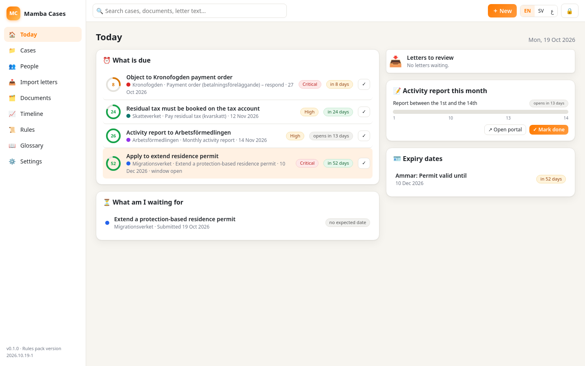
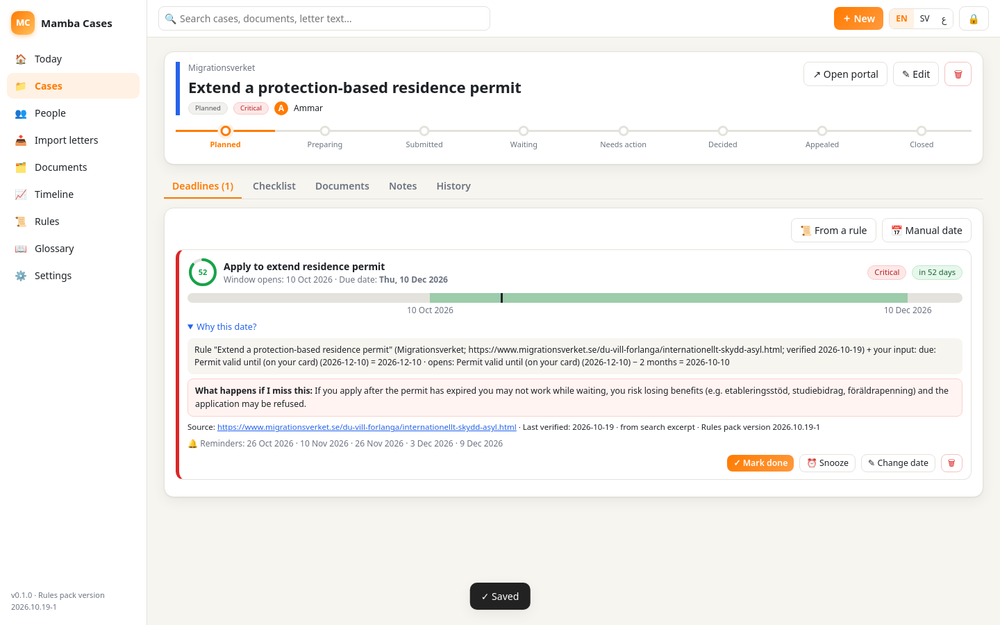
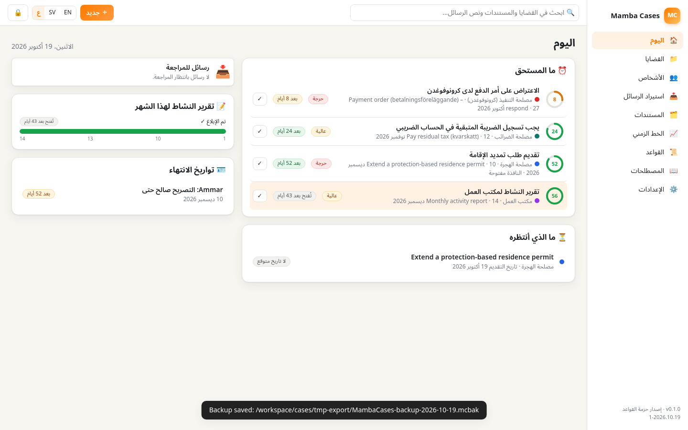
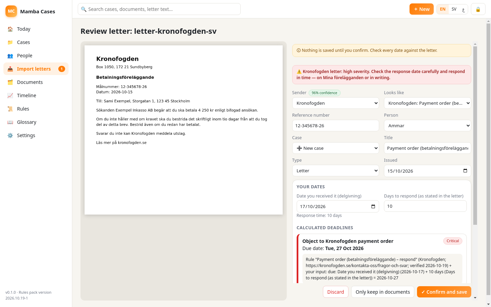
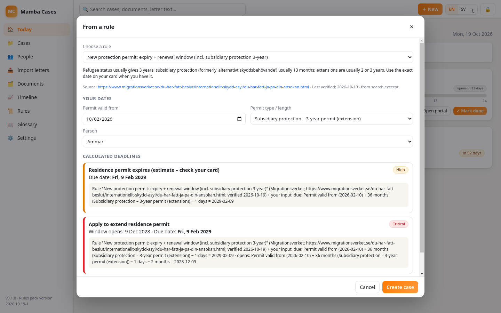
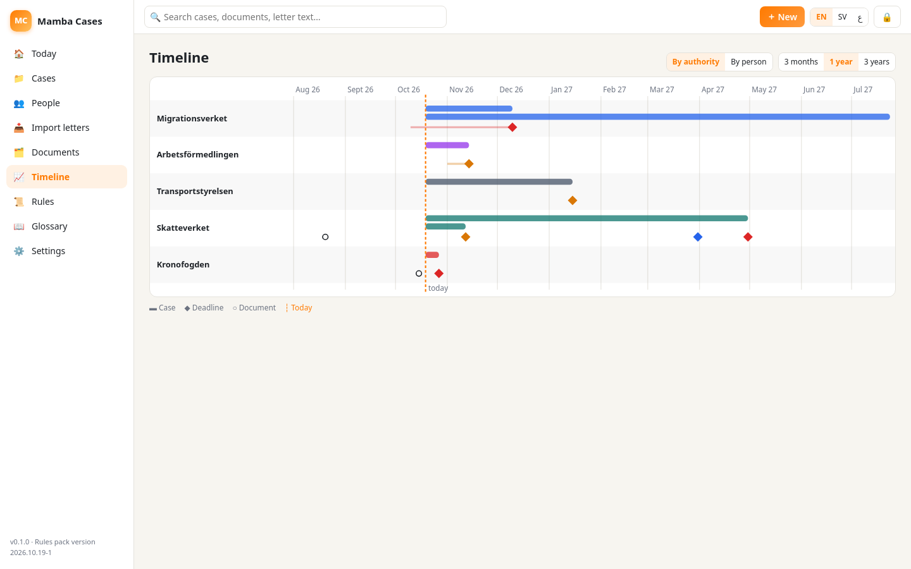

# Mamba Cases

**Mamba Cases** is an offline Windows app that tracks your cases and deadlines with Swedish agencies (Migrationsverket, Arbetsförmedlingen, Skatteverket, Försäkringskassan, CSN, Bostadsförmedlingen, Kronofogden, 1177 and more). It works in English, Svenska and العربية, with full right-to-left support.

- **Private by design:** no cloud, no account, no telemetry and no AI service. Data is encrypted on your PC with your PIN.
- **Sourced deadlines:** every rule links to the official page and shows the date it was last verified.
- **Letter import:** drop a PDF or a photo of a letter. Local OCR in Swedish, English and Arabic suggests the agency, case number and dates, and you confirm everything.

Download: [latest release](https://github.com/heisenberg0066/mamba-cases/releases/latest). The app is unsigned: in SmartScreen click *More info → Run anyway*.

| Today | Case with renewal window | Arabic (RTL) |
|---|---|---|
|  |  |  |
| Letter import (local OCR) | Rule picker: 3-year subsidiary protection | Timeline |
|  |  |  |

More screenshots are in [docs/](docs/).

## Features (v0.1.0)
- **People and cases** per agency, with an 8-step status, checklist, notes, history and linked documents.
- **Deadline rules engine** (`src/core/rules.js` and `src/core/rules-pack.json`):
  - date expressions, monthly windows (e.g. the AF report on the 1st–14th), consistency checks, severity-based reminder ladders and explanations in 3 languages;
  - Swedish public holidays and bank days computed locally. A deadline is **never moved later** than the official rule.
- **Letter import:** PDF via pdf.js text layer, with OCR as the fallback; images via tesseract.js (WASM) with bundled `swe`/`eng`/`ara` data. Rule-based extraction of agency, process, case/reference numbers, dates with their role (letter date, due, expiry, appointment), amounts, OCR/bankgiro, and masked personnummer. Every suggestion must be confirmed.
- **Document vault:** encrypted files with full-text search (Arabic normalisation, Swedish diacritics folding).
- **Timeline**, **Today dashboard**, **glossary** (sv–en–ar), **reminders** as Windows notifications (tray and start with Windows), **.ics export**.
- **Backup:** encrypted `.mcbak` with a separate passphrase, which can be restored on another PC.

## Rules pack 2026.10.19-1 (all verified 2026-10-19)
| Agency | Rule | Source |
|---|---|---|
| migrationsverket | Extend a protection-based residence permit | https://www.migrationsverket.se/du-vill-forlanga/internationellt-skydd-asyl.html |
| migrationsverket | New protection permit: expiry + renewal window (incl. subsidiary protection 3-year) | https://www.migrationsverket.se/du-har-fatt-beslut/internationellt-skydd-asyl/du-har-fatt-ja-pa-din-ansokan.html |
| migrationsverket | Extend a work permit | https://www.migrationsverket.se/du-vill-forlanga/arbeta/anstalld-eller-egen-foretagare/anstalld.html |
| arbetsformedlingen | Monthly activity report | https://arbetsformedlingen.se/for-arbetssokande/arbetslos---vad-hander-nu/aktivitetsrapportera |
| skatteverket | Report a move (flyttanmälan) | https://www.skatteverket.se/flyttanmalan |
| skatteverket | Income tax return (deklaration) | https://skatteverket.se/privat/deklaration/datumfordeklarationen2026.4.1997e70d1848dabbac95d72.html |
| skatteverket | Pay residual tax (kvarskatt) | https://www.skatteverket.se/kvarskatt |
| forsakringskassan | Report a change for housing allowance (bostadsbidrag) | https://www.forsakringskassan.se/privatperson/familj-och-barn/bostadsbidrag-for-barnfamiljer/meddela-andringar-om-bostadsbidraget |
| forsakringskassan | Monthly claim – establishment allowance (etableringsersättning) | https://www.forsakringskassan.se |
| csn | CSN annual repayment (paid once a year) | https://www.csn.se/fragor-och-svar/har-du-fatt-ett-slutligt-arsbelopp-som-ska-betalas-under-2026.html |
| csn | CSN reclaim after income check (fribelopp) | https://www.csn.se/fragor-och-svar/hur-stor-inkomst-far-jag-ha-nar-jag-studerar-med-studiemedel/inkomst-och-fribelopp.html |
| bostadsformedlingen | Stockholm housing queue yearly fee | https://bostad.stockholm.se/sa-gar-det-till/regler/avgift/ |
| kronofogden | Payment order (betalningsföreläggande) – respond | https://kronofogden.se/kontakta-oss/fragor-och-svar |
| kronofogden | Judgment (utslag) – apply for återvinning | https://lagen.se/sfs/1990_746.xhtml |
| transportstyrelsen | Foreign (non-EEA) driving licence stops being valid | https://www.transportstyrelsen.se/sv/vagtrafik/korkort/har-korkort/utlandska-korkort/ |
| 1177 | Healthcare appointment (kallelse) | https://www.1177.se |
| 1177 | Prescription renewal | https://www.1177.se/fragor--svar/e-tjanster/fragor-om-ombud/ |

Rules tagged `GK` (fk.etablering_monthly, 1177.*) are based on general knowledge rather than a quoted official page. Re-verify them before relying on them.

## Security
- A random 256-bit data key encrypts the vault and every stored file (AES-256-GCM).
- The data key is wrapped by a key derived from your PIN (scrypt, N=2^15). On Windows it is wrapped again with DPAPI (Electron `safeStorage`), so a copied vault folder can't be opened on another PC without the backup passphrase.
- After 5 wrong PINs an escalating lockout starts. Auto-lock follows the idle timer and the Windows session lock.
- Data lives in `%APPDATA%\Mamba Cases`.

## Develop
```bash
npm ci
npm start                      # run the app
OCR=1 node test/run-tests.js   # engine/vault/backup/ICS/extraction tests + local OCR
bash test/run-ui.sh            # Linux/xvfb: full UI flow, regenerates docs/*.png
npx electron-builder --win --x64 --publish never
"dist/win-unpacked/Mamba Cases.exe" --self-test
```
On every push, CI (`.github/workflows/build-windows.yml`, windows-latest) runs the tests, builds Setup/Portable/zip, runs the packaged `--self-test` and the UI test, then installs and uninstalls silently. Tags `v*` publish a release.

Test fixtures in `test/fixtures` are synthetic letters with fictional people and numbers.

## Licences
- App: MIT.
- Bundled components: Electron (MIT), tesseract.js and tesseract.js-core (Apache-2.0), tessdata `swe`/`eng`/`ara` 4.0.0_best_int (Apache-2.0), pdf.js (Apache-2.0), Noto Sans Arabic (SIL OFL 1.1).

*Not legal advice. Always check the date in your letter or with the agency.*
